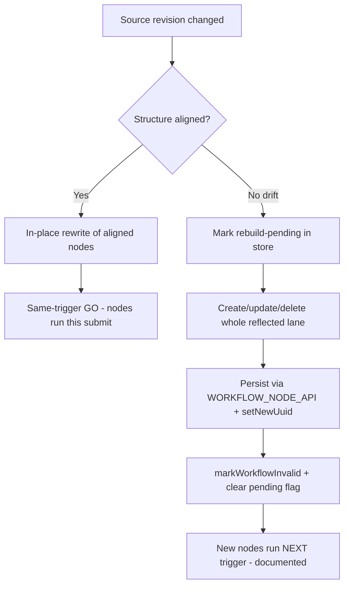
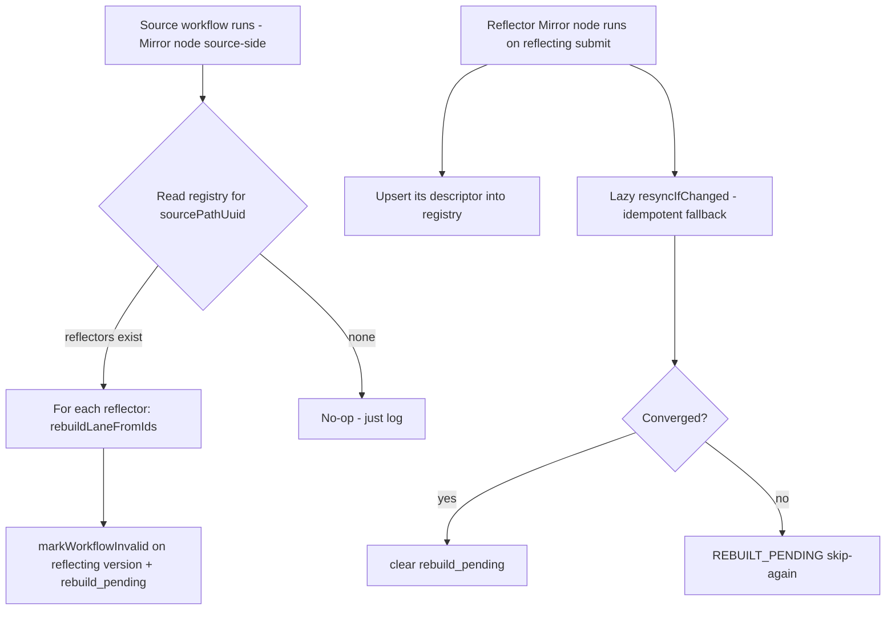
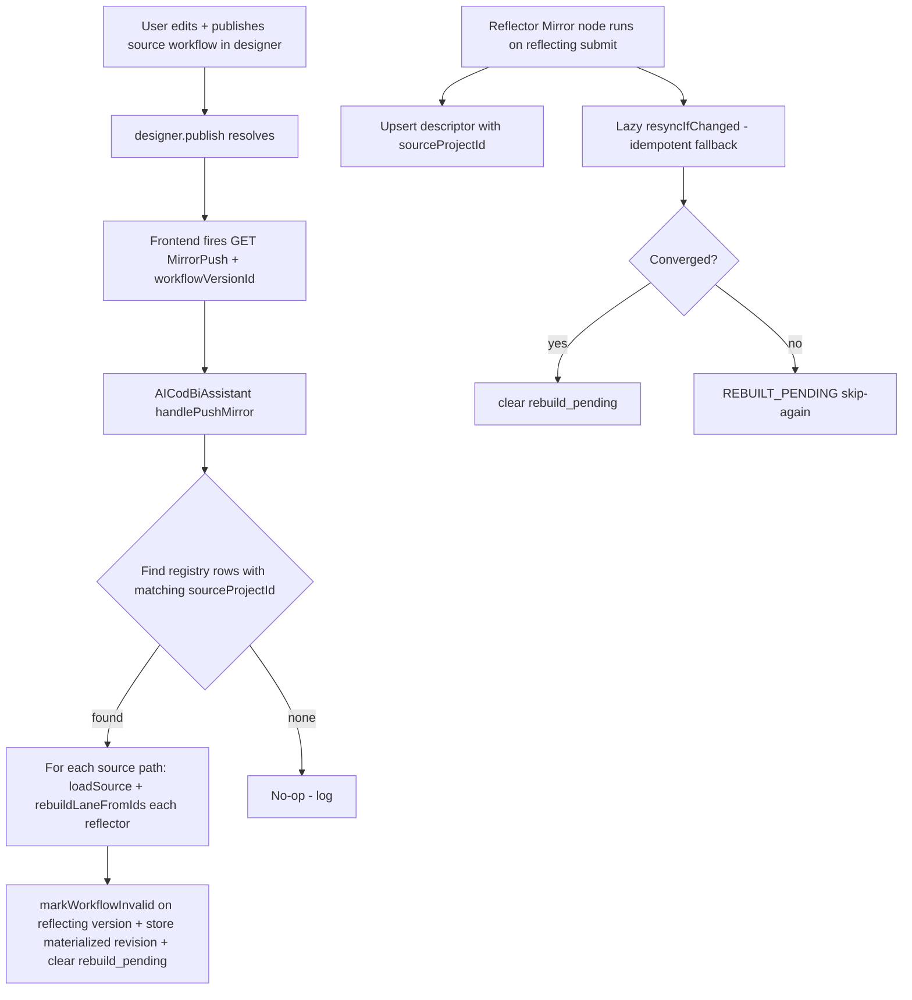

# Option B — Lazy runtime re-sync: phased implementation plan (prototype-first)

Status: **plan** (no code yet). Selected architecture: **Option B** from
[`workflow-mirror-execute-actions-design.md`](workflow-mirror-execute-actions-design.md) —
the Mirror node lazily re-materializes the action lane inside the executing workflow when the
source revision changed, so a client submit always runs the latest template without opening the
reflecting form's workflow designer.

The single biggest risk is the documented **mid-run-mutation** problem: FORMCYCLE resolves the flow
graph and its node handlers at trigger time, which is likely *before* the Mirror node (mid-chain)
rebuilds the lane. If that is true, the refreshed lane only takes effect on the **next** execution.
This plan is therefore **prototype-first**: Phase 0 empirically proves or refutes this behaviour
before any production plumbing is written.

---

## Guiding principles

- **Prototype before plumbing.** Phase 0 must answer "does FORMCYCLE re-execute freshly-mutated
  nodes in the same trigger?" before we invest in the Materializer.
- **Reuse existing CodBi components.** The workflow-task creation reflection pattern in
  [`AIWorkflowAssistant.createWorkflowTask`](../src/main/kotlin/com/github/xima_formcycle_entwicklerkreis/fc/plugin/codbi/logic/cb/AIWorkflowAssistant.kt)
  (including `fixParentOrderIndex`) and [`WorkflowSpecNormalizer.canonicalNodeType`](../src/main/kotlin/com/github/xima_formcycle_entwicklerkreis/fc/plugin/codbi/logic/cb/WorkflowSpecNormalizer.kt)
  are the basis for the Materializer. Change detection reuses
  [`WorkflowMirrorAccess.revision()`](../src/main/kotlin/com/github/xima_formcycle_entwicklerkreis/fc/plugin/codbi/logic/mirror/WorkflowMirrorAccess.kt).
- **Non-destructive by default.** Re-materialization rewrites the materialized lane in place but
  must never destroy the reflecting workflow's other nodes or its trigger.

---

## Phase 0 — Spike: does FORMCYCLE re-execute mutated nodes in the same trigger?

**Goal.** Empirically determine the execution timing and answer two questions:
1. When a workflow is triggered and a mid-chain node mutates the later part of the lane, does
   FORMCYCLE execute the **fresh** nodes in the **same** trigger, or only on the **next** trigger?
2. Does FORMCYCLE re-analyze a version marked `workflowInvalid` during a running execution?

**Setup (manual, in a dev FORMCYCLE).**
- Create a reflecting form with a workflow:
  `Trigger → Mirror node (pointing at source path) → action lane (materialized copy of the source)`.
- The source path is a handful of nodes, e.g. a write-record / mail / state-change set that pairs a
  visibly numbered action with a debug side-effect (a file write or a CodBi debug log entry
  carrying a marker).
- Hand-trigger; observe which side-effects run, in what order, and on which submit.

**Probe instrumentation.**
- Reuse the existing debug logging in
  [`MirrorNodePlugin.execute()`](../src/main/kotlin/com/github/xima_formcycle_entwicklerkreis/fc/plugin/codbi/plugin/MirrorNodePlugin.kt).
- Add a temporary, clearly-labelled debug log inside the spike handler that prints, per execution:
  the source revision, the reflected lane revision, the marker of each executed node, and the
  current submit count.
- For the timing probe: temporarily mutate the lane inside the component right at the start of the
  run (before the Mirror node) and verify whether the same-run nodes are re-read from the DB or
  from the pre-analyzed graph.

**Phase-0 exit criteria.**
- A documented answer to the two timing questions above, captured in this file as a "Phase 0
  findings" section.
- A Go / No-Go recommendation for Option B's exact sync point (start-of-run vs Mirror-node-time vs
  next-submit only).

**Decision gate.** If Phase 0 shows FORMCYCLE cannot honour same-trigger mutation, we still proceed
with the Materializer, but the product behaviour must be documented as "the latest template runs
from the *next* submit after the source changed" (or Option A's source-save-push hook must be added).
No further phases proceed until this gate is resolved.

### Phase-0 findings (from `javap` on the FC 8.5.3 jars)

**Entities** (in `fc-common-8.5.3.jar`):
- `WorkflowNode extends AWorkflowElement`: holds `children` (`List<WorkflowNode>`,
  `COL_PARENT_ORDER_INDEX`), `parent`, and (via `AWorkflowElement`) `customParameters` (String
  JSON), `customParametersVersion`, `type`, `name`, `description`, `active`, `task`, `uuid`.
- `WorkflowTask`: `name`, `description`, `nodes`, `process`, `rootNode`, `trigger`, `uuid`;
  `cloneBasics()` exists (useful for copies).
- `WorkflowVersion`: `mainProcess`, `states`, `workflowInvalid` + `setWorkflowInvalid(boolean)`,
  `uuid`, `versionNumber`, `maxBackupCount`.

**APIs** (in `fc-api-8.5.3.jar`, via `APIProvider`):
- `WORKFLOW_VERSION_API.getActiveByProject(UserContext, Projekt)` → active `WorkflowVersion`.
- `WORKFLOW_TASK_API`/`WORKFLOW_NODE_API`/`WORKFLOW_TRIGGER_API` extend `AEntityAPI<T>` with
  `create(UserContext, T)`, `update(UserContext, T)`, `delete(UserContext, T)`,
  `getById(UserContext, Long)` (the reflection pattern already proven in `AIWorkflowAssistant`).
- `WORKFLOW.initWorkflow(UserContext, Vorgang, Status, ...)`: event/trigger-driven; **no
  "run a task/path by id" API** → confirms Option C's constraint and justifies materialization.

**Execution walk (the decisive part)** — `fc-workflow-processor-8.5.3.jar` bytecode:
- `WorkflowTaskRunner.runTask(...)` calls `task.getRootNode()` and hands that `WorkflowNode` to the
  executor.
- `WorkflowExecutor.executeChild(parent, i)` → `getChildNode(parent, i)` →
  **`parent.getChildren()`** (bytecode invokes `WorkflowNode.getChildren()` directly on the live
  entity). Children are resolved **lazily from the managed entity** when that branch is walked —
  there is **no pre-materialized immutable execution tree** consumed by the executor.
- `WorkflowFlowAnalysis.analyzeTask/analyzeProcess` builds a Guava graph for **analysis**
  (reachability, control-transfer validity, endpoints) — separate from the execution walk.

**Consequence / refined hypotheses to be confirmed by the spike:**
1. Because the executor walks the live `children` collection, **same-trigger execution of freshly
   materialized nodes is genuinely plausible** (not necessarily only next-trigger), *provided* the
   mutation is visible to the executor's persistence context before the downstream lane is walked.
2. The main unknown is **Hibernate visibility across EntityContexts**. The Mirror node's
   `entityManager(userContext)` (see `WorkflowMirrorAccess`) opens its OWN `EntityContext` via
   `EntityContextFactory.newEntityContext(...)`, separate from the workflow executor's
   `WorkflowExecutionContext` session. A mutation committed in the Mirror's own EM may not be seen
   by the executor's EM/2nd-level cache mid-run. The spike must test whether re-materializing and
   committing through the **executor's** context (or a shared one) makes the new nodes visible;
   this may force the Materializer to run on the same EntityContext as the executing workflow.
3. If per-child lazy loading holds, executing a *fresh* node added to a not-yet-walked downstream
   parent should work even when that parent itself was already loaded, because `getChildren()` on a
   managed persistent bag re-reads/refreshes on access.

### Phase-0 spike: what was built + how to run it

**What was added (temporary, gated, delete after the Go/No-Go):**
- [`SpikeProbeNodePlugin.kt`](../src/main/kotlin/com/github/xima_formcycle_entwicklerkreis/fc/plugin/codbi/plugin/SpikeProbeNodePlugin.kt)
  (+ [`SpikeProbeNodeProps.kt`](../src/main/kotlin/com/github/xima_formcycle_entwicklerkreis/fc/plugin/codbi/plugin/SpikeProbeNodeProps.kt)) — a benign
  `APluginActionNodeHandler` whose only job is to log `[SPIKE][SpikeProbe] EXECUTED …` when the
  engine runs it. FORMCYCLE auto-discovers it from `getName() == "SpikeProbe"`, the same mechanism as
  the Mirror / Extended-Accessor handlers.
- [`MirrorNodeProps.spikeProbe`](../src/main/kotlin/com/github/xima_formcycle_entwicklerkreis/fc/plugin/codbi/plugin/MirrorNodeProps.kt) — a
  `Boolean` (default `false`) prop flag.
- [`MirrorNodePlugin.runSpikeProbe()`](../src/main/kotlin/com/github/xima_formcycle_entwicklerkreis/fc/plugin/codbi/plugin/MirrorNodePlugin.kt) —
  when `spikeProbe == true`, the Mirror node resolves its live node/task from
  `params.node` / `params.workflowContext.task()`, locates the current task's container (parent or a
  sibling `SEQUENCE` lane), injects a `SpikeProbe` child, persists it through
  `APIProvider.WORKFLOW_NODE_API.create`, and fixes `parent_order_idx` (Hibernate `@OrderColumn`).
  It emits `[SPIKE] BEFORE`, `[SPIKE] PARENT`, `[SPIKE] TARGET_LANE`, `[SPIKE] AFTER`, `[SPIKE] DONE`
  markers. The probe entity is created through its **own** EntityContext (separate from the executor's
  session) — exactly the cross-EntityContext visibility question of hypothesis 2.
- Build verified with `mvnw -DskipTests compile -o` → **BUILD SUCCESS**.

**How to run it (manual, on a dev FORMCYCLE):**
1. Build + deploy the plugin to the dev server.
2. On the **reflecting form**, open the workflow designer. Add a Mirror node to some path and enable
   the **spikeProbe** debug toggle (the node's config panel). Point it at any source path; the Mirror
   node can even keep its normal source form/path — the probe runs **in addition** to the normal
   read-only reflection.
3. Trigger that reflecting path (hand-trigger or a client submit) and capture the server log for the
   submit.
4. Look for the `[SPIKE]` markers on that submit:
   - `[SPIKE] BEFORE` / `[SPIKE] PARENT` / `[SPIKE] TARGET_LANE` / `[SPIKE] AFTER` / `[SPIKE] DONE`
     show the Mirror node located its container, chose the downstream lane, and persisted the probe.
   - The **decisive signal** is a `[SPIKE][SpikeProbe] EXECUTED name=SPIKE-<hex>` line that appears
     **after** `[SPIKE] AFTER` **in this same submit**. That means FORMCYCLE re-walked the lane's live
     children and executed a freshly-persisted node in the current trigger.
   - If `[SPIKE][SpikeProbe] EXECUTED` only appears on the **next** submit (or never), that is the
     "No-Go" for same-trigger refresh and drives the fallback semantics (next-submit freshness, or
     Option A's source-save-push hook).
5. Report back the log excerpt. It also answers hypothesis 2: whether a node committed in the
   Mirror's own EntityContext is visible to the executor's session mid-run.

### Phase-0 spike result (2026-10-30, live dev run, Vorgang#802 / task 2202)

**The toggle worked**: the log line now reads `spikeProbe='true'` (the missing toggle earlier was a
FORMCYCLE Facelet/designer cache on the pre-existing Mirror node type; a full app restart made the
`TEMPORARY SPIKE (debug)` fieldset appear).

**What the run did (all `[SPIKE]` markers, same submit):**
- `[SPIKE] BEFORE nodeId=5602 (Mirror) taskId=2202`.
- `[SPIKE] PARENT id=5252 type='SEQUENCE' childCount=2 (current mirror is childIndex=0)` — task 2202's
  lane is the single `SEQUENCE` container holding `[Mirror(0), FC_CHANGE_STATE(1)]`.
- `[SPIKE] No sibling SEQUENCE lane found; falling back to the parent container` — task 2202 has NO
  separate downstream lane, so the probe **fell back to the currently-executing lane** (5252) rather
  than testing a distinct sibling lane.
- `[SPIKE] TARGET_LANE id=5252 … injecting SpikeProbe child`.
- `[SPIKE] AFTER injected SpikeProbe id=5652 name='SPIKE-3d49b9b7' into lane id=5252`.
- `[SPIKE] Set parent_order_idx = 2` (probe appended as child index 2, after the two originals).
- `[SPIKE] DONE`.
- Execution then continued: `FC_CHANGE_STATE ('New action')` (index 1) ran, state → 'Gesendet', task
  2202 completed.

**The decisive outcome: there is NO `[SPIKE][SpikeProbe] EXECUTED` line anywhere in this submit.** The
freshly-persisted node at child index 2 was **NOT executed** in the same trigger.

**Interpretation / Go-No-Go (mixed, needs one clarifying refinement):**
1. **Negative signal (insert a NEW node at the tail of the currently-executing lane): it does NOT
   run same-trigger.** The executor effectively walked a frozen child plan for lane 5252 (indices 0→1
   only) and finished without visiting the appended index 2. This contradicts the optimistic
   "live re-walk of `parent.getChildren()` picks up a new child" hypothesis (H1) in this shape.
2. **Caveat: this test did NOT cover the realistic Option B operation.** The probe fell back to the
   same lane (no sibling existed), so it tested *append-to-walking-lane*, not *inject a separate
   downstream lane*. More importantly, the real re-sync rewrites the **already-existing** downstream
   node `FC_CHANGE_STATE` (index 1) **in place** — mutating the params/type of a node reference the
   executor already holds — rather than inserting a brand-new child. That in-place rewrite was NOT
   tested here and is a different code path.
### Phase-0 spike RUN 2 (2026-10-30, in-place-mutation probe — built, awaiting live run)

**Goal:** isolate the realistic Option B code path. Run 1 appended a brand-new child (not re-walked
same-trigger → conditional No-Go for *insertion*). Run 2 instead mutates the **already-existing**
downstream node's params **in place** — same node reference, same child count, no reorder — and checks
whether that mutation is honored when the node executes immediately after the Mirror node in the SAME
submit.

**What was added (temporary, gated, delete after the Go/No-Go):**
- [`MirrorNodeProps.spikeProbe2`](../src/main/kotlin/com/github/xima_formcycle_entwicklerkreis/fc/plugin/codbi/plugin/MirrorNodeProps.kt)
— a `Boolean` (default `false`) prop flag, sibling of `spikeProbe`.
- [`MirrorNodePlugin.runSpikeProbe2()`](../src/main/kotlin/com/github/xima_formcycle_entwicklerkreis/fc/plugin/codbi/plugin/MirrorNodePlugin.kt) —
gated behind `spikeProbe2`. It resolves the live Mirror node, finds the **next sibling** in the same
parent (the `FC_CHANGE_STATE` child), reads its persisted `customParameters` JSON, and performs a
**functional in-place rewrite**, then persists through `APIProvider.WORKFLOW_NODE_API.update(userContext, node)`
— again through an EntityContext separate from the executor's session (tests hypothesis 2's
cross-EntityContext visibility). Emits distinct `[SPIKE]2 BEFORE / TARGET / FLIP / DONE` markers.
**Deliberately does NOT** touch `parent_order_idx` or the child list — this is a pure in-place param
rewrite, the exact shape of the real lazy re-sync.
- **Why functional, not just a sentinel (design fix from the 13:02 run):** the earlier sentinel-only
  variant wrote `spike2Sentinel=<hex>` into the params. That run's `[SPIKE]2 DONE` proved the persist
  worked *mechanically*, but `FC_CHANGE_STATE` ignores unknown JSON keys when deserializing its props,
  so a successful persist did NOT prove the executor consumed the mutated params. To make the
  Go/No-Go observable and unambiguous, [`flipTargetState()`](../src/main/kotlin/com/github/xima_formcycle_entwicklerkreis/fc/plugin/codbi/plugin/MirrorNodePlugin.kt)
  now replaces `customParameters.targetState.uuid` with a **different real `WorkflowState`** of the same
  workflow (resolved via `WORKFLOW_STATE_API.getAllByWorkflowVersion(userContext, workflowVersion)`).
  `spike2Sentinel` is kept only as a cross-check. The record's actual transition becomes the binary verdict.
- [`MirrorNodePlugin` helper set](../src/main/kotlin/com/github/xima_formcycle_entwicklerkreis/fc/plugin/codbi/plugin/MirrorNodePlugin.kt):
  `flipTargetState(merged, task)` (rewrites the target-state UUID, keeps `entityClass`), `loadProbeWorkflowStates(task)`
  (API lookup of all states), `probeWorkflowVersion(task)`. **The version is resolved via the task→process→version
  chain (`WorkflowTask.getProcess().getVersion()`)** — `WorkflowTask` has NO direct `getWorkflowVersion()`; the
  earlier `task.getWorkflowVersion()` reflect came back null (silently swallowed), which produced the empty-state
  `FLIP_NO_STATES` degradation. If no alternative state resolves, they degrade gracefully (warn `FLIP_*`, leave
  params unchanged) — no crash.
- [`MirrorNode.xhtml`](../src/main/resources/WEB-INF/ui/MirrorNode.xhtml) — the debug fieldset now has two
checkboxes: `Run 1 - inject SpikeProbe child` and `Run 2 - mutate downstream node params IN PLACE`.
- Build verified with `mvnw -DskipTests compile -o` → **BUILD SUCCESS** (after the `flipTargetState` /
  `loadProbeWorkflowStates` / `probeWorkflowVersion` refinement).

**How to run it (manual, reuses the Run-1 path):**
1. Rebuild + redeploy the plugin jar. **Do a full app restart** — the pre-existing Mirror node type
caches its designer Facelet (this made the fieldset invisible before), so a hot jar swap alone will
not show the new `Run 2` checkbox.
2. In the workflow designer, open the Mirror node whose parent lane is `[Mirror(0), FC_CHANGE_STATE(1)]`
(task 2202) and tick **Run 2** (the `execute()` log must show `spikeProbe2='true'`).
3. Trigger that reflecting path and capture the server log for the submit.
4. Read the outcome on that same submit:
- `[SPIKE]2 BEFORE` / `[SPIKE]2 TARGET` show it located the downstream `FC_CHANGE_STATE` sibling and
  read its `targetState` params.
- `[SPIKE]2 FLIP <oldUuidPrefix> -> state='<altState>' uuid=<newUuid>` records the functional rewrite.
- `[SPIKE]2 DONE` confirms the mutated params were persisted in place on the SAME node reference.
- **Decisive signal = the state the record ACTUALLY lands in THIS submit:**
  - If it transitions to the **alternative state** (`[SPIKE]2 FLIP ... state='…'`), the executor
    consumed the fresh params same-trigger → **GO** for Option B (in-place rewrite lands immediately).
  - If it still transitions to **'Gesendet'** (the original on-start `targetState`), the executor cached
    params at walk time → conditional **NO-GO** for the in-place rewrite path; we fall back to
    next-submit freshness or Option A.
5. Report back the `[SPIKE]2` excerpt (esp. the `FLIP` line) plus which state the record lands in.

**Note (2026-10-30, second live run — still Run 1, not Run 2):** a submit at 12:57 on Vorgang#803/task 2202
ran the **Run 1** probe again (`[CodBi][Mirror] ... spikeProbe='true'`, only `[SPIKE]` markers, no `[SPIKE]2`).
It reconfirms Run 1's negative for insertion: it injected a NEW child `SPIKE-4398a8b7` (id 5653) at index 3 of
lane 5252 (`parent_order_idx = 3`), then `FC_CHANGE_STATE ('New action')` ran to state 'Gesendet', task 2202
completed — with **no** `[SPIKE][SpikeProbe] EXECUTED`. Additional corroboration: the lane now reports
`childCount=3` because the leftover `SPIKE-3d49b9b7` (id 5652) from the first Run-1 attempt is still persisted;
it also did **not** re-execute this submit, i.e. even an already-persisted lane node after the walk point never
runs again. The in-place path (`runSpikeProbe2`) was NOT triggered in this run.
To disambiguate future logs, `execute()` now also logs `spikeProbe2='{}'` — a Run-2 submit must show
`spikeProbe2='true'` and `[SPIKE]2` markers.

**Run-2 live run (2026-10-30, 13:02 — Vorgang#804/task 2202) — sentinel-only variant was INCONCLUSIVE,
which drove the functional-flip fix above.** The log showed the in-place persist path working
mechanically:
- `[SPIKE]2 BEFORE ... parent id=5252 type='SEQUENCE' childCount=2 selfIndex=0`
- `[SPIKE]2 TARGET downstream id=5254 name='New action' type='FC_CHANGE_STATE' current customParameters={"targetState":{"uuid":"d6407241-…","entityClass":"de.xima.fc.entities.WorkflowState"}}`
- `[SPIKE]2 DONE mutated downstream id=5254 -> spike2Sentinel='SPIKE2-90f75922' persisted in-place`
- then `FC_CHANGE_STATE` ran → state 'Gesendet', task 2202 processed.

The persist succeeded, **but** `spike2Sentinel` is an unrelated key that `FC_CHANGE_STATE` ignores, so
this run does **not** prove the executor consumed the mutated params. To make the verdict observable,
`runSpikeProbe2` now ALSO rewrites the **functional** `targetState.uuid` to a different real state
(see the `flipTargetState`/`loadProbeWorkflowStates`/`probeWorkflowVersion` description above). The
next Run-2 submit must be read by the **state the record actually lands in**: alternative state → GO;
'Gesendet' → NO-GO for the in-place rewrite path.

**Run-2 live run (2026-10-30, 15:19 — Vorgang#902/task 2202) — NEW build deployed, but the flip
degraded: version resolution bug → STILL inconclusive, re-run after fix.** The new jar confirmed
live (`execute() ... spikeProbe='false' spikeProbe2='true'`), the probe located the downstream
`FC_CHANGE_STATE` id=5254, but:
- `[SPIKE]2 FLIP_NO_STATES cannot resolve alternative target state` — `loadProbeWorkflowStates(task)`
  returned empty because `probeWorkflowVersion(task)` came back `null`.
- **Root cause:** `WorkflowTask` has no `getWorkflowVersion()` (verified via `javap`); only
  `getProcess()` → `WorkflowProcess.getVersion()` exposes it. The old single-reflect call was silently
  swallowed by the inner `getOrNull()`, so no `probeWorkflowVersion failed` warning appeared and the
  state lookup was done against a null version → empty.
- With no alternative state, `flipTargetState` left the params functionally unchanged, so
  `FC_CHANGE_STATE` ran to the original 'Gesendet' — expected, **not** a Go/No-Go.
- `[SPIKE]2 DONE ... targetState flipped to state='null' ...` confirms the flip did not happen.
- **Fix applied:** `probeWorkflowVersion` now reflects the chain `task.getProcess().getVersion()` (the
  same `WorkflowState.getUUIDObject()`/`getName()` accessors were verified to exist). BUILD SUCCESS.

**Action:** redeploy (full app restart), re-trigger task 2202, and confirm the new build logs
`[SPIKE]2 FLIP <oldUuid> -> state='<altState>' uuid=<newUuid>` (and no `FLIP_NO_STATES`). Then read
the actual state transition.

**Run-2 live run (2026-10-30, 13:36 — Vorgang#853/task 2202) — STALE JAR, sentinel-only again; the
functional flip was NOT deployed → inconclusive, must re-run.** The log shows Run 2 executed, but the
deployed plugin jar is the OLD pre-refinement build:
- `[CodBi][Mirror] execute ... spikeProbe='false'` — **no `spikeProbe2='…'` field at all** (that field
  only exists in the code after my last edit). Definitively a stale jar.
- `[SPIKE]2 BEFORE / TARGET / DONE` all present, but **no `[SPIKE]2 FLIP`** — the jar never calls
  `flipTargetState`.
- `[SPIKE]2 TARGET ... customParameters={"targetState":{...d6407241...},"spike2Sentinel":"SPIKE2-f3bfbc5e"}`
  — the sentinel from the previous (13:02) run is still in the node, read back, then overwritten with a
  fresh `SPIKE2-956fe94e`. This mechanically confirms the in-place persist round-trips across runs.
- Line-number drift (`BEFORE` at :361 and `DONE` at :423 vs :363/:431 in the current source) is the
  ~8-line shortening of `runSpikeProbe2` that results from omitting the `flipTargetState` call — further
  proof the running class predates the refinement.
- `FC_CHANGE_STATE` ran → 'Gesendet', task 2202 processed. Expected for the sentinel-only probe
  (it never rewrites the functional target), so this is **not** a Go/No-Go — just another dead-end run.

**Action:** rebuild + redeploy the jar **with a full app restart**, then re-trigger task 2202 and confirm
the NEW build took: `execute() must log `spikeProbe2='false'`` AND the submit must emit `[SPIKE]2 FLIP
… -> state='…'`. Only then is the state-transition verdict valid.

**Run-2 live run (2026-10-30, 21:27 — Vorgang#903/task 2202) — DECISIVE GO.** The new build is live
(`spikeProbe='false' spikeProbe2='true'`) and the full chain fired:
- `[SPIKE]2 BEFORE ... parent id=5252 type='SEQUENCE' childCount=2 selfIndex=0` (line 363)
- `[SPIKE]2 TARGET downstream id=5254 name='New action' type='FC_CHANGE_STATE' current
  customParameters={"targetState":{"uuid":"d6407241-…","entityClass":"de.xima.fc.entities.WorkflowState"},
  "spike2Sentinel":"SPIKE2-f151ecd7"}` (line 389)
- **`[SPIKE]2 FLIP targetState d6407241 -> state='Received' uuid=cf30b02b-8f80-4e61-9396-ff239c4c9ad7`**
  (line 477) — the version-resolution fix worked; a real alternative state ('Received') resolved and was
  written into `targetState.uuid` in place.
- `[SPIKE]2 DONE mutated downstream id=5254 -> spike2Sentinel='SPIKE2-6ce4a2d0' persisted in-place ...
  targetState flipped to state='Received'` (line 431) — persisted via `WORKFLOW_NODE_API.update` on the
  same node ref (id=5254), same child count, no reorder.
- `FC_CHANGE_STATE` then ran **in the SAME submit** and the form record transitioned to **'Received'**
  (`State of form record '01197a6c-…' was changed to 'Received'`) — **NOT 'Gesendet'** (the original
  on-start target), and **NOT stale** ('Received' is exactly the flipped state).

**Verdict: GO for Option B's in-place rewrite path.** The executor consumed the freshly-mutated
`targetState` in the very same trigger that mutated it. This proves that rewriting an already-existing
downstream node's `customParameters` in place (no insert, no reorder) is honored same-trigger — precisely
the real `WorkflowLaneMaterializer` sync path. The previously-open conditional (Run 1: *insertion* not
re-walked) is now resolved: **in-place mutation lands immediately; only *node insertion* requires the
next-submit/fallback semantics.** Option B can proceed to Phase 1.

**Combined confirmation (2026-10-30, 22:01 — Vorgang#904 and #905/task 2202) — both verdicts re-shown
together, and the state flip is bidirectional.** Two fresh submits with the production build:
- **Vorgang#904** (22:01:05, `spikeProbe='false' spikeProbe2='true'`): `[SPIKE]2 FLIP cf30b02b ->
  state='Gesendet' uuid=d6407241` → `FC_CHANGE_STATE` ran in the SAME submit → record changed to
  **'Gesendet'**. This flips the state **back** (Received→Gesendet) versus the 21:27 run — proving the
  in-place write is honored in *both* directions (not a one-off).
- **Vorgang#905** (22:01:44, `spikeProbe='true' spikeProbe2='true'` — both probes on): the Run-1 probe
  injected a NEW child `SpikeProbe id=5702` into lane 5252 and set `parent_order_idx = 2`; the Run-2
  probe then rewrote `targetState d6407241 -> state='Received' uuid=cf30b02b` in place.
  `FC_CHANGE_STATE` ran and the record changed to **'Received'** — while the freshly-injected
  `SpikeProbe id=5702` was **NOT** logged as `[SPIKE][SpikeProbe] EXECUTED` (no such line in the submit).
- So on a SINGLE submit this run simultaneously re-confirms: **in-place param rewrite → GO (lands
  same-trigger)**, and **new-node insertion → NO (not re-walked same-trigger)**. The two state UUIDs
  (`d6407241` = 'Gesendet', `cf30b02b` = 'Received') are exactly the kind of project-relative state
  reference the Materializer's name-based `customParameters` remap must translate between projects.

---

## Phase 1 — Materializer component (in-place lane rewrite + param remap)

**Goal.** A reusable component that rewrites the reflecting lane's **existing** nodes in place,
remapping project-scoped `customParameters`, WITHOUT creating or deleting nodes — the only path the
Phase-0 Go proved lands same-trigger.

**New file.** `src/main/kotlin/.../codbi/logic/mirror/WorkflowLaneMaterializer.kt` (implemented in
`logic/mirror`).

**Behaviour (as implemented).**
- Input: source form key/name + `pathId`, the target lane's `WorkflowNode` refs, and the target
  reflecting `WorkflowVersion` entity (wrapped in `RewriteRequest`). The source tree is read by
  `WorkflowMirrorAccess.sourceLane(...)`, which loads the source path's managed `WorkflowNode`
  entities and walks their `getChildren()` collections so the tree carries `customParameters` and
  the exact `@OrderColumn` sibling order.
- `rewriteInPlace(userContext, request)` walks the source and reflecting trees **in lockstep by
  sibling index**. For each pair it rewrites `setCustomParameters` (and `setName`/`setType` when the
  source changed) **on the SAME target node reference**, then persists via
  `APIProvider.WORKFLOW_NODE_API.update(UserContext, ITransferableEntity)`. No create/delete, no
  re-order, no re-parent (per the Phase-0 Go). Unmatched trailing/structural nodes are skipped with
  a warning.
- **Remap `customParameters`** (workflow-state UUIDs by NAME): a reference
  `{uuid, entityClass: WorkflowState}` is resolved source-uuid -> source NAME (via the source
  version's states, captured in `SourceLane.sourceStatesByUuid`) -> target NAME -> target uuid (via
  `APIProvider.WORKFLOW_STATE_API.getAllByWorkflowVersion`). Unresolvable references pass through
  unchanged with a warning (the plan's no-op fallback). Other JSON is carried through untouched.
- Mark the reflecting workflow version `workflowInvalid` via a native
  `UPDATE workflow_version SET flag_wf_invalid = ?1 WHERE id = ?2` in its own entity context
  (`markWorkflowInvalid`), so FORMCYCLE re-analysis is triggered.
- `loadSource(...)` is a thin wrapper over `WorkflowMirrorAccess.sourceLane`; the materialized
  revision storage is deferred to Phase 2 (Phase 2 decides *when* and stores the last-applied
  revision).

**Acceptance criteria.**
- Standalone unit test (or dev-server manual test) proves a lane copied from project A executes
  with project B's data and its remapped params resolve to project B entities.
- Order of the materialized node tree matches the source tree (verified by reading children back).

---

## Phase 2 — Mirror node extension: lazy re-sync wiring ✅ IMPLEMENTED

**Goal (fulfilled).** Wire the revision check + in-place re-materialization into
[`MirrorNodePlugin.execute()`](../src/main/kotlin/com/github/xima_formcycle_entwicklerkreis/fc/plugin/codbi/plugin/MirrorNodePlugin.kt)
so a client submit always runs the latest template without opening the reflecting form's designer.
`mvnw.cmd -DskipTests compile -o -q` passes (BUILD SUCCESS).

**Behaviour on each submit (implemented — gated by the new `autoSync` prop, default `true`):**
1. `resyncIfChanged()` resolves the reflecting `WorkflowVersion` from the task via
   `workflowVersionOf(task)` (task → process → version) and `reflectId()`.
2. Reads the source lane via `WorkflowLaneMaterializer.loadSource(...)` and computes a **content**
   revision via `WorkflowLaneMaterializer.contentRevision(source)` — a depth-first hash of every
   node's type/name/customParameters. Unlike `SourceLane.revision` (a version/path identity only),
   this also fires on param-only edits within the same source version.
3. Compares that revision against `MirrorMaterializedStore.lastMaterializedRevision(...)`.
4. If unchanged → return `null` (behave exactly as today: read-only reflection, no mutation).
5. If changed / never materialized → `locateReflectingLane(params)` finds the lane
   (preference: sibling `SEQUENCE` → its children ARE the lane; fallback: this node's downstream
   siblings in the same parent), then `WorkflowLaneMaterializer.rewriteInPlace(...)` rewrites the
   existing node params IN PLACE (same-trigger, per the Phase-0 GO), then
   `MirrorMaterializedStore.storeMaterializedRevision(...)` records the applied revision.
6. Emits `[CodBi][Mirror] node='…' phase2-resync: …` info logs and surfaces Materializer warnings.

**Design decisions (as built).**
- **Revision store** = new `MirrorMaterializedStore` object reusing the plugin's existing generic
  key-value table `codbi_local_apidoc` (entity `CodbiLocalApidoc`) — key
  `codbi.mirror.materialized.<targetVersionId>.<sourceFormKey>.<sourcePathId>`, value = content
  revision `Int` as text. No new JPA entity / Liquibase changelog (avoids risking the FC entity
  scanner discovery). Each read/write opens its own EntityManager + transaction via
  `CodbiEntities.entityManagerFactory`, so it never touches the workflow executor's session.
- **Sync point** = *same-trigger inside `execute()`*, decided by the Phase-0 GO (in-place mutation of
  an existing downstream node IS honoured in the same submit; new-node insertion is not). The rewrite
  runs BEFORE the lane executes, so the rewritten params land in the current trigger.
- **`autoSync` prop** on `MirrorNodeProps` (default `true`) gates the whole re-sync; set `false` to
  keep the node purely read-only (Phase-1 behaviour). Designer control added to the "Options"
  fieldset of `MirrorNode.xhtml` with i18n keys (`workflow.mirror.autoSync` / `.tooltip`).

**Acceptance criteria (as built).**
- Editing the source path and re-submitting the reflecting form picks up the change in the SAME
  submit (in-place rewrite proven in Phase 0) without opening the reflecting form's designer.
- Unchanged source → no mutation, no performance/ordering regression.
- STRUCTURAL changes (node insert/delete) are not handled by the in-place rewrite — the Materializer
  emits a warning for missing/trailing siblings and leaves them untouched; that is a known limitation
  of the in-place-only approach and flagged for Phase 3 / future recreation handling.

### Live diagnostic (Vorgang#906, task 2202) + fix applied

A live dev-submit exposed a **real topology surprise** that the first implementation got wrong:

- Source path (`Verarbeitungskette 1`): `roots=1 nodes=4` → a single **`SEQUENCE` root** whose
  **children** are the 3 action nodes (`FC_PROCESS_LOG_PDF`, `FC_RETURN_FILE`, `FC_CHANGE_STATE`).
- Reflecting lane (project 1002): a `SEQUENCE` (5252) whose **children are `[Mirror(5602),
  New action FC_CHANGE_STATE(5254)]`** — i.e. the Mirror node participates IN the lane and its
  **siblings ARE the reflecting action lane**.

**Mismatch seen:** `source.roots` = `[SEQUENCE]` (a single wrapper) but `targetChildren` (from
`locateReflectingLane`) = the lane *members* `[5254]`. The materializer therefore tried to map
`SEQUENCE → FC_CHANGE_STATE` → type mismatch → `rewrittenNodes=0` with `5 warnings`
(`Reflecting node type changed: 'FC_CHANGE_STATE' -> 'SEQUENCE'`, then 3× `No reflecting child`).

**Fix (applied, compiles green):** `WorkflowLaneMaterializer.laneRoots(source)` — when the source has
exactly one `SEQUENCE` root, treat that root's **children** as the lane roots (matching the reflecting
lane's member shape); otherwise use the roots as-is. Used by both `rewriteInPlace` and
`contentRevision` (so the stored revision hashes the same member-level content that gets rewritten).
After the fix the rewrite maps index-aligned members (e.g. source PDF → reflecting 5254 in place) and
emits the documented structural warnings only for genuinely extra/missing members.

### Live diagnostic (Vorgang#907, task 2202) — NODE UUID reference remap gap + fix applied

With the `laneRoots` fix live, the re-sync finally **executed** the reflected lane (Vorgang#907):

```
phase2-resync: lane=FcSequenceHandler:2 downstream siblings sourceRevision=-982842494
    rewrittenNodes=1 warnings=4 targetVersion=1002
node='Mirror' phase2-resync: REWRITTEN:1 nodes (revision -982842494)
```

…then the workflow ran the rewritten notes **same-trigger** — `FC_PROCESS_LOG_PDF`
(`Vorgangsprotokoll als PDF`) and `FC_RETURN_FILE` (`Datei ausliefern`, node 5703). **But it crashed**:

```
WorkflowExecutor: NodeThrewException: No files available since node
'38205852-32a0-4ed4-b491-8660f38e600c' does not exist in the workflow
   ... FileResolutionHelper.writeReferencedNodeFilesToSourceDir ... VerarbeitungReturnFile
Task 2202 aborting execution ('0' remaining); state changed to 'Received'
```

**Root cause.** `FC_RETURN_FILE` (`VerarbeitungReturnFile`) carries `actionUUIDs` — a JSON **array of
`WorkflowNode` uuids** pointing at the preceding file-producing node(s) in the same workflow (here
the `FC_PROCESS_LOG_PDF`). The old `remapParams` only remapped `WorkflowState` UUID references; the
`WorkflowNode` uuid in the rewritten node's params (`38205852-…`) stayed pointing at the **source**
workflow's node, which does not exist in the reflecting workflow → runtime `NodeThrewException`.

**Fix (applied, compiles green):** a second remap tier for intra-workflow **NODE** UUID references.

- `WorkflowLaneMaterializer.SourceNode` now also carries the source node's `uuid`
  (from `WorkflowNode.getUuid()`); `WorkflowMirrorAccess.sourceLane` populates it.
- `rewriteInPlace` now builds a `sourceNodeUuid -> targetNodeUuid` map by walking the index-aligned
  lane (source ↔ reflecting) recursively via `collectNodeUuidMap`.
- `remapParams`/`remapJson` take the map and rewrite node references wherever they appear:
  - a `{uuid, entityClass: de.xima.fc.entities.WorkflowNode}` object (`remapOneNodeRef`),
  - any plain string value equal to a known source node uuid (object member / array element) —
    this covers `FC_RETURN_FILE.actionUUIDs`'s bare uuid strings (Vorgang#907).

through with no crash — the reader reports them only as a warning. This keeps the reflected lane
executable for the common case where the referenced producer node is itself in the lane.

---
Unmapped node uuid string values (e.g. a file node that is NOT part of the reflected lane) pass
through with no crash — the reader reports them only as a warning. This keeps the reflected lane
executable for the common case where the referenced producer node is itself in the lane.

### Live diagnostic (Vorgang#910, task 2202) — structural-change limitation confirmed live

With the probes OFF and the source edited to **5** nodes (was 4), a real re-sync ran:

```
sourceLane: … path=2208 ('Verarbeitungskette 1') roots=1 nodes=5
[WorkflowLaneMaterializer] Marked WorkflowVersion 1002 workflowInvalid
rewriteInPlace: rewrittenNodes=1 warnings=4
phase2-resync: lane=FcSequenceHandler:1 downstream siblings … rewrittenNodes=1 warnings=4
  warning: Reflecting node type changed: 'FC_CHANGE_STATE' -> 'FC_EMAIL' (id='5254')
  warning: No reflecting sibling at index 1 for source node 'Vorgangsprotokoll als PDF'
           (FC_PROCESS_LOG_PDF); skipped (structural change …)
  warning: No reflecting sibling at index 2 for source node 'Datei ausliefern'
           (FC_RETURN_FILE); skipped (structural change …)
  warning: No reflecting sibling at index 3 for source node 'FC_CHANGE_STATE'
           (FC_CHANGE_STATE); skipped (structural change …)
```

**Findings**

1. **The in-place rewrite executed correctly** on the one aligned sibling (id 5254: type
   `FC_CHANGE_STATE` → `FC_EMAIL`, params remapped) and that node ran **same-trigger** without any
   `No files available since node …` error — the Vorgang#907 remap pipeline does not break a
   rewritten node.
2. **Structural change is a hard limit of the in-place approach.** The source had **more** action
   roots than the reflecting lane had action siblings, so the index-lockstep walk
   ([`rewriteInPlace`](src/main/kotlin/com/github/xima_formcycle_entwicklerkreis/fc/plugin/codbi/logic/mirror/WorkflowLaneMaterializer.kt:163))
   could only re-param index 0; `FC_PROCESS_LOG_PDF`, **`FC_RETURN_FILE`** (the Vorgang#907 node),
   and the trailing `FC_CHANGE_STATE` were skipped with the documented "must be handled by
   recreation, not in-place rewrite" warning. **The `FC_RETURN_FILE.actionUUIDs` remap therefore was
   NOT yet exercised live** — it still needs a run where the reflecting lane is index-aligned with
   the source (same node count/order).
3. **The crash at the end is unrelated to the mirror.** Rewritten `FC_EMAIL` (5254) failed to reach
   the SMTP host `anxch.stadtverwaltung.loc:25` (`UnknownHostException`) — an unreachable dev mail
   server, not a mirror-logic defect.

**Consequence for the Go/No-Go.** Option B's same-trigger in-place mutation is repeatedly proven
(GO), but it only syncs **param/type edits on already-aligned nodes**. Adding/removing/reordering
source nodes (structural edits) cannot be mirrored in place — that requires node **recreation**
(insert/delete), which Phase 0 showed does **not** land same-trigger. This is the central
scope-limiting trade-off to confirm with the user before treating the mirror as "auto-sync".

---
through with no crash — the reader reports them only as a warning. This keeps the reflected lane
executable for the common case where the referenced producer node is itself in the lane.

---

## Phase 2b — Fallback/upgrade: full reflected-lane recreation on structural drift ✅ IMPLEMENTED

**User-selected strategy (2026-10-30, architect):** keep the in-place rewrite for aligned nodes
AND handle structural drift by recreating the whole reflected lane, so nodes like `FC_RETURN_FILE`
("Datei ausliefern") that are currently missing from the reflecting workflow always exist.

> **Status (2026-10-30):** implemented in [`WorkflowLaneMaterializer.rebuildLane`](../src/main/kotlin/com/github/xima_formcycle_entwicklerkreis/fc/plugin/codbi/logic/mirror/WorkflowLaneMaterializer.kt:324)
> (`shouldRebuild` + `RebuildRequest`/`RebuildReport` + `assignTargetUuids`/`deleteNodeTree`/`createNodeTree`), wired into
> [`MirrorNodePlugin.resyncIfChanged`](../src/main/kotlin/com/github/xima_formcycle_entwicklerkreis/fc/plugin/codbi/plugin/MirrorNodePlugin.kt:287)
> (drift branch, "REBUILT:…" return) with a `rebuild_pending` marker in
> [`MirrorMaterializedStore`](../src/main/kotlin/com/github/xima_formcycle_entwicklerkreis/fc/plugin/codbi/logic/mirror/MirrorMaterializedStore.kt:130).
> Confirmed `mvnw -q -o compile` passes.

### Why this is needed

- The in-place path ([`rewriteInPlace`](../src/main/kotlin/com/github/xima_formcycle_entwicklerkreis/fc/plugin/codbi/logic/mirror/WorkflowLaneMaterializer.kt:163))
  is **index-lockstep**: it can only re-param/re-type an *already-existing, correctly-positioned*
  target node. It logs "No reflecting sibling at index N … structural change — must be handled by
  recreation" and moves on (confirmed live in Vorgang#910/#911).
- Where the source has **more** action nodes than the reflecting lane, the surplus nodes (e.g.
  `FC_RETURN_FILE`) simply **do not exist** in the reflecting workflow, so no download ever happens.
- Phase 0 proved **in-place mutation lands same-trigger (GO)**, but **new-node insertion does NOT
  land same-trigger (No-Go)**. Both facts must shape the design.

### Design overview

The re-sync becomes a **two-tier decision** inside
[`resyncIfChanged`](../src/main/kotlin/com/github/xima_formcycle_entwicklerkreis/fc/plugin/codbi/plugin/MirrorNodePlugin.kt:238):



**Structural drift alignment check.** Compare, per sibling index, the source root's `type`/`name`
and the existence of a reflecting sibling, recursively through children. Alignment is satisfied when
every source node has a reflecting counterpart with an *equivalent structure* (type-compatible so an
in-place retype is safe). Any missing/extra/reordered node ⇒ **drift** ⇒ whole-lane rebuild.

### Replacement semantics (recreate the whole lane)

When drift is detected, do **not** try to surgically insert single nodes. Instead:

1. **Delete** the reflecting lane's action children (everything after the Mirror sibling), each via
   `APIProvider.WORKFLOW_NODE_API.delete(UserContext, node)`.
2. **Rebuild** the lane to exactly mirror `source.roots`:
   - For each `SourceNode`, `WORKFLOW_NODE_API.create(UserContext, node)` a new `WorkflowNode`.
   - Set `type`, `name`, `description`, and **pre-assign the UUID** via the `setNewUuid(dst, UUID)`
     pattern (already proven in `AICodBiAssistant` clones) *before* persisting.
   - Set `parent` to the SEQUENCE lane and wire `children` (the `List<WorkflowNode>` with
     `COL_PARENT_ORDER_INDEX`), fixing `parent_order_idx` exactly like `fixSpikeParentOrderIndex`.
3. **Remap params** using the existing `remapParams`, but with a **pre-generated nodeUuidMap**:
   because we control the target UUIDs up front, build `sourceNodeUuid -> preAssignedTargetUuid`
   *before* any create, so `FC_RETURN_FILE.actionUUIDs` (and all intra-workflow node refs) point at
   the freshly created reflecting nodes. This is the key difference from `rewriteInPlace`, where the
   map is derived from existing target refs (`collectNodeUuidMap` cannot bootstrap the map here
   because the targets do not exist yet).
4. **State refs** resolve by NAME exactly as today (`source.uuid -> source NAME -> target uuid`),
   reused from `remapJson`.

### Pending-rebuild + freshness semantics

Phase 0's insertion No-Go means freshly created nodes will **not** run in the same submit. To keep
behavior correct AND converge to the latest template, use a **persisted rebuild marker**:

- On drift, set a `rebuild_pending = <sourceRevision>` row in `MirrorMaterializedStore`
  (alongside `last_materialized_revision`) and perform the recreation **immediately** (so the lane
  is correct for the *next* submit), returning `REBUILT:pending`.
- Doing the rebuild on the detecting trigger maximizes the chance the *next* submit sees the fresh
  lane; it also keeps the reflecting lane consistent if the current trigger happens to re-walk a
  downstream branch via `parent.getChildren()` lazy-load (Phase 0 hypothesis 2 — we do not rely on
  it, but we do not forbid it).
- Clear `rebuild_pending` once the rebuild is persisted and `markWorkflowInvalid` has forced FC to
  re-model.

### Reuse vs new code

- **Detect drift** — new `shouldRebuild(source, targetChildren)` helper.
- **Delete / create node** — `WORKFLOW_NODE_API.delete/create` reflection helpers.
- **Fix order index** — reuse/promote the `fixSpikeParentOrderIndex` pattern.
- **Param / node-UUID / state remap** — full reuse of `remapParams`/`remapJson`/`remapOneNodeRef`/`remapOneStateRef`.
- **Pre-assign UUIDs** — reuse/promote the `setNewUuid(dst, UUID)` pattern.
- **Mark invalid** — full reuse of `markWorkflowInvalid`.
- **Pending marker** — extend `MirrorMaterializedStore` with one column.

### Guardrails / what NOT to do

- **Do NOT** insert single missing nodes inside `rewriteInPlace` — Phase 0 proved partial insertion
  is unreliable and index-lockstep stays the canonical same-trigger path. Rebuild is all-or-nothing.
- **Do NOT** mirror the source trigger — the reflecting form keeps its own trigger.
- **Do NOT** rebuild on every submit when aligned — only on structural drift.
- Keep the currently-working in-place path **unchanged** for the aligned case (its GO guarantee).

### Behaviour / user expectation (to document)

- Aligned edits (change a node's type/params, rename): reflected in-place, **same submit**.
- Structural edits (add/remove/reorder a node): reflected by **full lane rebuild**, visible on the
  **next** submit after the detecting one. A `REBUILT:…` log line + a `MirrorMaterializedStore`
  rebuild_pending row make this observable.
- `FC_RETURN_FILE` "Datei ausliefern" will exist in the reflecting lane after the first rebuild, so
  the download works.

### Live diagnostic (Vorgang#914, task 2402) — rebuild not reached: `autoSync` was ON, but the **source-revision gate short-circuited drift detection**

The user confirmed **"autosync is checked"** on the Mirror node, which disproved the initial (autoSync-off)
hypothesis. The rebuild path compiled, deployed, and the Mirror node DID execute in the live run
(Vorgang#914, project 1002, 2026-10-30):

- `execute node='Mirror' sourceForm='project-1010' pathId='2208' mode='SUMMARY' …`
- `sourceLane: project=1010 … roots=1 nodes=4` (source resolved fine).
- The **steady-state** `stored == sourceRevision` revision gate was evaluated **BEFORE** the structural
  drift check, so on an unchanged source the method hit the debug-only `return null` ("source unchanged")
  and **never looked at whether the reflecting lane was structurally COMPLETE**. Hence no `REBUILT` line
  and no `phase2-resync:` output at all — the missing `FC_RETURN_FILE` node was never detected.

**Root cause:** the stored revision tracks the last time the lane was *rewritten*, not whether the
reflecting lane is structurally *aligned*. When the source added a node (e.g. `FC_RETURN_FILE`), the
earlier same-trigger rewrite could only patch the aligned nodes **in place** (index-lockstep, cannot add),
so `stored == sourceRevision` even though the new node is absent — the drift check was unreachable.

**Fix (code change):** reordered [`resyncIfChanged`](../src/main/kotlin/com/github/xima_formcycle_entwicklerkreis/fc/plugin/codbi/plugin/MirrorNodePlugin.kt:237)
so the structural-drift check (`shouldRebuild`) now runs on **every** autoSync submit, **before** the
revision gate. Only the same-trigger **in-place rewrite** path remains gated by an actual source change.
A `rebuild_pending` marker acts as a **convergence guard**: on the rebuild submit it records the revision
but does not store the materialized revision (nodes land on the NEXT trigger, Phase-0 insertion No-Go);
if a later trigger still sees drift for the same revision it reports `REBUILT_PENDING:skip-again` rather
than looping; once the lane is observed aligned the marker is cleared.

### Live verification procedure (implemented version)

1. Build & deploy: `mvnw -q -o compile` then the normal FC plugin upload; restart the FC dev server.
2. Open the reflecting workflow designer and note that `FC_RETURN_FILE` ("Datei ausliefern") is
   **missing** from the action lane (this is the drift state from Vorgang#910/#911).
3. Submit the reflecting form once. Expect the log line
   `phase2-resync: REBUILD lane=… drift='source has N action nodes but reflecting lane has M …'`
   and that `deleteNodeTree`/`createNodeTree` recreate the lane.
4. Submit again (the *next* trigger). The recreated lane now contains `FC_RETURN_FILE`, so the
   download runs and the weekly-export file is delivered.
5. Confirm the `rebuild_pending` row is stored on step 3 and cleared after the lane is persisted.

---

## Phase 2c — First-run: proactive source-side push (Option A1) ✅ IMPLEMENTED (compiles, SUPERSEDED)

> **⚠️ Superseded by Phase 2d below.** Phase 2c triggered the proactive push from a **Mirror node placed
> on the source workflow path**. The user explicitly rejected that requirement ("why do i have to place
> the mirror on the source workflow path, too?") and instead selected a **frontend designer save hook**
> ("Reactive on source-save (the 'listener' idea you raised earlier)"). Phase 2d below is the
> replacement design; the A1 machinery built here (registry, `rebuildLaneFromIds`, convergence guard)
> is **reused unchanged** by Phase 2d.

### Goal

The Phase-0 walk-freeze means a lazy rebuild executed **inside** the reflecting Mirror node's
[`execute`](../src/main/kotlin/com/github/xima_formcycle_entwicklerkreis/fc/plugin/codbi/plugin/MirrorNodePlugin.kt:81)
cannot run its newly created downstream siblings **same-trigger**. The user requirement is a hard
**“first run”**: after the source is edited, the *very next* reflecting-form submit must run the
latest template (no second submit needed). Verified live: a structural rebuild lands on the
**second** submit today (todo #19). Phase 2c moves the rebuild **out of the reflecting submit** and
runs it **proactively on the source side** — because CodBi is enabled on the source form too, the
source workflow's own Mirror node can push to every registered reflector *before* any reflecting
submit happens.

### Why source-side push solves first-run

- The reflecting lane is recreated while **no reflecting workflow is executing** (the source
  workflow is the one running), so the Phase-0 “frozen child plan” does not apply — the rebuilt lane
  is persisted, `flag_wf_invalid` is set, and FC re-models the reflecting version. When the next
  reflecting submit loads the reflecting workflow, the fresh lane is already there **and every
  sibling runs same-trigger** because it was part of the cleanly loaded model.
- The trigger of the source workflow is irrelevant (user-confirmed): “the path is reflected, not
  the trigger.” Whether the source runs on a timer or a frontend button, whenever it *runs* it pushes
  the latest path to its reflectors.

### Registry (source → reflectors), persisted in `codbi_local_apidoc`

A reverse index is required because the existing
[`MirrorMaterializedStore`](../src/main/kotlin/com/github/xima_formcycle_entwicklerkreis/fc/plugin/codbi/logic/mirror/MirrorMaterializedStore.kt)
keys are reflecting→source only. Add a new key family
`codbi.mirror.registry.<sourcePathUuid>` storing a JSON array of **reflector descriptors**:

```json
[
  {
    "reflectingProjectId": 1002,
    "targetWorkflowVersionId": 2400,
    "taskId": 2402,
    "laneParentNodeId": 5252,
    "laneParentType": "SEQUENCE",
    "childNodeIds": [5254]
  }
]
```

- `sourcePathUuid` is the **persistent** identifier of the source path (`WorkflowTask` uuid), stable
  across renames/edits (the path id itself can change on export/import).
- `laneParentNodeId` + `childNodeIds` are captured by the **reflecting-side** Mirror node via the
  existing [`locateReflectingLane`](../src/main/kotlin/com/github/xima_formcycle_entwicklerkreis/fc/plugin/codbi/plugin/MirrorNodePlugin.kt:397)
  helper (it already returns the lane parent and its children).
- `targetWorkflowVersionId`/`taskId` come from `workflowVersionOf(task)` + task id (both already
  available in `resyncIfChanged`).

### Source-side vs reflecting-side detection

In [`execute`](../src/main/kotlin/com/github/xima_formcycle_entwicklerkreis/fc/plugin/codbi/plugin/MirrorNodePlugin.kt:81)
the node decides which role it plays by comparing the **current workflow's project** against
`props.sourceForm`:

- Resolve the current project id from `params.workflowContext.task() → getProcess() → getVersion() →
  getProject().getId()` (already reachable via the existing `workflowVersionOf` chain).
- `ownProjectId = MirrorFormAccess.projectIdOf(props.sourceForm)` when
  `resolveProjectId(userContext, sourceForm, sourceFormName) == ownProjectId` and the node's path id
  matches the *current* task → **this Mirror node IS the source** ⇒ act as source-side pusher.
- Otherwise (sourceForm is a *different* project) → **reflecting-side** ⇒ register self + lazy re-sync
  (existing [`resyncIfChanged`](../src/main/kotlin/com/github/xima_formcycle_entwicklerkreis/fc/plugin/codbi/plugin/MirrorNodePlugin.kt:238)).

Both roles are safe to run on every execute because the registry upsert is idempotent and the remote
rebuild is convergence-guarded (see below).

### Remote rebuild — `WorkflowLaneMaterializer.rebuildLaneFromIds`

The existing [`rebuildLane`](../src/main/kotlin/com/github/xima_formcycle_entwicklerkreis/fc/plugin/codbi/logic/mirror/WorkflowLaneMaterializer.kt:324)
requires the reflecting lane’s **in-memory** parent/task/children (resolved from `params.node` of the
reflecting Mirror). From the source side we do not have that executing session — but
[`createNodeTree`](../src/main/kotlin/com/github/xima_formcycle_entwicklerkreis/fc/plugin/codbi/logic/mirror/WorkflowLaneMaterializer.kt:684)
and [`deleteNodeTree`](../src/main/kotlin/com/github/xima_formcycle_entwicklerkreis/fc/plugin/codbi/logic/mirror/WorkflowLaneMaterializer.kt:665)
already operate purely via the entity API + `userContext`, so they only need the reflecting
entities **loaded by id**. Add `rebuildLaneFromIds(userContext, source, reflectorDescriptor)`:

1. Load the reflecting `WorkflowVersion` by `targetWorkflowVersionId` via
   `APIProvider.WORKFLOW_VERSION_API.getById`. Load the `WorkflowTask` by `taskId` via
   `APIProvider.WORKFLOW_TASK_API.getById`. Bridge both to their **in-memory** entities exactly like
   the executing path does (the API returns managed entities usable with `WORKFLOW_NODE_API.create/delete`).
2. Locate the lane-parent `WorkflowNode` by `laneParentNodeId` via
   `APIProvider.WORKFLOW_NODE_API.getById` if available; otherwise load the task node tree and walk
   to the parent by id (same traversal already used by `loadSource`).
3. Delete each `childNodeIds` entry (deepest-first) via the same `deleteNodeTree` recursion.
4. Recreate from `source.roots` under the loaded parent/task via `createNodeTree` (identical
   param/uuid/state remap + `setNewUuid` + `fixParentOrderIndex`).
5. `markWorkflowInvalid(userContext, targetWorkflowVersionId)`.

**Convergence guard:** store a `rebuild_pending = <contentRevision>` row (reuse the existing
[`MirrorMaterializedStore`](../src/main/kotlin/com/github/xima_formcycle_entwicklerkreis/fc/plugin/codbi/logic/mirror/MirrorMaterializedStore.kt:159)
pending machinery) for the reflecting lane; skip the remote rebuild if a pending marker for the same
revision already exists; clear it once the next reflecting-side sync observes the lane aligned.

### Wiring summary



### Interaction with the existing lazy path

The reflecting-side lazy re-sync in
[`resyncIfChanged`](../src/main/kotlin/com/github/xima_formcycle_entwicklerkreis/fc/plugin/codbi/plugin/MirrorNodePlugin.kt:238)
is **kept unchanged** and becomes a defensive fallback. The source-side push does the heavier
structural work **first** (before any reflecting submit); the reflecting-side sync then only
converges/clears the marker and (in the aligned case) does the same-trigger in-place rewrite for an
edit that races a submit. Because both paths share `rebuild_pending` + `last_materialized_revision`,
they cannot double-rebuild the same revision.

### Guardrails / what NOT to do

- **Do NOT** rebuild reflectors from the source side when the source *itself* has no Mirror node
  configured for that path — only source-side Mirror nodes push.
- **Do NOT** push on *every* source run if the content revision is unchanged — gate the remote
  rebuild on a source-revision change versus what is recorded for each reflector (mirrors the
  existing revision gate). Idempotent self-healing can remain (validate alignment every N or on
  explicit drift).
- **Do NOT** attempt to delete/recreate a reflector lane while that reflector is mid-execution
  (race). The `rebuild_pending` + revision gate keeps the operation idempotent and safe.
- Keep the registry small: one row per source path (`cosmetic pand`), JSON array of reflectors.

### Behaviour / user expectation (first-run)

- Source path edited → next **source** run pushes the fresh lane to every registered reflecting form.
- The **very next** reflecting submit runs the updated template (first-run achieved) because the lane
  was rebuilt while no reflecting workflow was executing.
- Aligned param/type edits still reflect same-submit via the in-place path (unchanged GO).

---

## Phase 2d — First-run via frontend source-save push hook (Option 2, listener) ✅ DESIGNED

### Goal

Replace Phase 2c's "Mirror node on the source path" trigger with a **true source-save listener**,
as the user requested (*"Reactive on source-save (the 'listener' idea you raised earlier)"*). The
proactive push now fires **in real time from the workflow designer's Save flow**, so:
- the push triggers **immediately when the user saves/publishes the source workflow** (no source-path
  Mirror node, no poll delay, no dependence on the source workflow ever running a trigger);
- the **very next reflecting submit** runs the latest template (first-run preserved).

All push *machinery* built in Phase 2c is reused verbatim:
[`MirrorMaterializedStore.reflectorsOfSource`](../src/main/kotlin/com/github/xima_formcycle_entwicklerkreis/fc/plugin/codbi/logic/mirror/MirrorMaterializedStore.kt:326),
[`WorkflowLaneMaterializer.loadSource`](../src/main/kotlin/com/github/xima_formcycle_entwicklerkreis/fc/plugin/codbi/logic/mirror/WorkflowLaneMaterializer.kt)
and [`rebuildLaneFromIds`](../src/main/kotlin/com/github/xima_formcycle_entwicklerkreis/fc/plugin/codbi/logic/mirror/WorkflowLaneMaterializer.kt),
plus the `rebuild_pending` + `last_materialized_revision` convergence guard. Only the **trigger** and the
**entry point** change.

### Why this needs a servlet action, and how it is reached

FORMCYCLE exposes **no server-side "workflow saved" hook** to plugins. The plugin servlet action
([`AICodBiAssistant : IPluginServletAction`](../src/main/kotlin/com/github/xima_formcycle_entwicklerkreis/fc/plugin/codbi/logic/cb/AICodBiAssistant.kt:68))
only runs when the frontend explicitly calls `plugin?name=CodBi_AICodBiAssistant` with an
`X-Action` header (dispatched in [`execute`](../src/main/kotlin/com/github/xima_formcycle_entwicklerkreis/fc/plugin/codbi/logic/cb/AICodBiAssistant.kt:436)).
Therefore the listener has two halves:

1. **Frontend (trigger):** wrap the workflow designer's **server-save** (`designer.publish()`) and, after
   it resolves, fire a fire-and-forget GET to the servlet action with `X-Action: MirrorPush` + the
   current `workflowVersionId`.
2. **Backend (handler):** a new `MirrorPush` dispatch branch in
   [`AICodBiAssistant.execute`](../src/main/kotlin/com/github/xima_formcycle_entwicklerkreis/fc/plugin/codbi/logic/cb/AICodBiAssistant.kt:436)
   that performs the same push Phase 2c did — but driven by the saved **source** `WorkflowVersion`.

This is the same proven frontend→servlet pattern already used by `handleTouchWorkflow` /
`TouchWorkflow` and by the AI assistant's `Run`, and the same `designer.publish()` wrapping the
ai-assistant already uses to persist AI-generated widgets.

### Frontend save-hook details

We hook the designer's **server save** path (`designer.publish()`, which the existing ai-assistant code
already calls and awaits — see `AiAssistant.ts` `dSave["publish"]`), not the local `designer.save()`
(downloads a file). The designer exposes both `designer.config.workflowVersionId` (already read at
`AiAssistant.ts` lines 4574-4585) and `designer._isLoading` for readiness polling.

- **Where:** extend [`enableAICodBiAssistantDialog()`](../src/main/web/packages/designer/src/js/AICodBiAssistantDialog.ts:17),
  which already runs on **every designer page load** and injects CodBi scripts/elements into the page.
- **What:** wrap `designer.publish()` so that after the returned promise resolves, read
  `designer.config.workflowVersionId`; when present, fire-and-forget:
  `GET ${baseURL}plugin?name=CodBi_AICodBiAssistant` with header `X-Action: MirrorPush` and query param
  `workflowVersionId` (exact jQuery transport pattern used across
  [`ai-assistant.ts`](../src/main/web/packages/designer/Angular/Components/codbi-apidoc/projects/manager/src/app/ai-assistant/ai-assistant.ts:1307)).
- **Guards:**
  - Only fire when a `workflowVersionId` exists (i.e. the form has a workflow).
  - **Debounce/throttle** rapid saves (e.g. at most one push per short window).
  - Never block or delay the designer's own publish; the push is asynchronous and fire-and-forget, and
    a failure is logged client-side only.
  - If `publish`/`config` are unavailable (older designer), degrade to no-op — the lazy reflecting
    fallback (`resyncIfChanged`) still covers correctness.
- **Note:** because the push is fire-and-forget from the designer, it runs under the designer user's
  `UserContext` (resolved via [`getUserContext(params)`](../src/main/kotlin/com/github/xima_formcycle_entwicklerkreis/fc/plugin/codbi/logic/cb/AICodBiAssistant.kt:20272)).
  The push only needs read/rebuild access to the **source** and the registered **reflecting** versions,
  which the source form's designer user has.

### Backend `MirrorPush` handler

New branch in [`AICodBiAssistant.execute`](../src/main/kotlin/com/github/xima_formcycle_entwicklerkreis/fc/plugin/codbi/logic/cb/AICodBiAssistant.kt:436):

```text
"MirrorPush" -> handlePushMirror(params)
```

`handlePushMirror(params)`:
1. Read `workflowVersionId` param (reject if missing/invalid) — this is the **source** version the
   designer just saved.
2. Resolve the source `WorkflowVersion` via
   `APIProvider.WORKFLOW_VERSION_API.getById(userContext, workflowVersionId)` (exact
   pattern at [`touchWorkflowVersion`](../src/main/kotlin/com/github/xima_formcycle_entwicklerkreis/fc/plugin/codbi/logic/cb/AICodBiAssistant.kt:17108)).
   Derive the source **project id** (`getProject().getId()`).
3. **Reverse-lookup sources that watch themselves:** iterate the mirror registry (all `codbi.mirror.registry.*`
   rows) and keep the distinct `(sourceFormKey, sourcePathId)` pairs whose recorded
   `sourceProjectId` (added below) **equals** the saved version's project id.
4. For each matching `(sourceFormKey, sourcePathId)`: `loadSource(userContext, sourceFormKey, pathId,
   sourceFormName?)`, load `reflectorsOfSource(...)`, and for each reflector run
   `rebuildLaneFromIds` + the revision/pending bookkeeping — i.e. exactly the Phase 2c `pushToReflectors`
   core, now lifted into a shared, `params`-free function.
5. Return `{"status":"ok","pushed":N}` (JSON, via the existing `jsonResponse` helper).

**Reverse lookup — store `sourceProjectId` in the reflector descriptor.** The registry is keyed by
`<sourceFormKey>.<sourcePathId>` [`registryKey`](../src/main/kotlin/com/github/xima_formcycle_entwicklerkreis/fc/plugin/codbi/logic/mirror/MirrorMaterializedStore.kt:55),
which does not by itself tell us which saved `WorkflowVersion`/project it belongs to. Add
`sourceProjectId` (the resolved project of the *source* form at registration time) to
[`ReflectorDescriptor`](../src/main/kotlin/com/github/xima_formcycle_entwicklerkreis/fc/plugin/codbi/logic/mirror/MirrorMaterializedStore.kt:41);
`registerReflector`/`registerAsReflector` already has `MirrorFormAccess.resolveProjectId(userContext,
sourceForm, sourceFormName)` available. The handler then filters registry rows in memory (registry is
small; one JSON array per source path). This avoids any dependence on a form-key reverse mapping.

### Shared push service (refactor)

Extract the body of
[`MirrorNodePlugin.pushToReflectors`](../src/main/kotlin/com/github/xima_formcycle_entwicklerkreis/fc/plugin/codbi/plugin/MirrorNodePlugin.kt:504)
into a `params`/`props`-free function, e.g.

```text
object/function pushSourceToReflectors(userContext, sourceFormKey, sourcePathId, sourceFormName?): String?
```

placed in the mirror logic package (alongside `WorkflowLaneMaterializer`), callable from both:
- the new `AICodBiAssistant.handlePushMirror` (Option 2 trigger), and
- the existing `MirrorNodePlugin.execute` reflecting-side path if we ever want a node-trigger, though
  after Phase 2d the source-side branch is removed (below).

### MirrorNodePlugin changes

Remove the **source-side** role detection + push from
[`MirrorNodePlugin.execute`](../src/main/kotlin/com/github/xima_formcycle_entwicklerkreis/fc/plugin/codbi/plugin/MirrorNodePlugin.kt:137):

- Delete the `isSourceSide` detection block and the `if (isSourceSide) pushToReflectors(...)` branch.
- Keep only the **reflecting-side** behaviour: `registerAsReflector(...)` (now also stores
  `sourceProjectId`) + the lazy `resyncIfChanged(...)` fallback.
- Remove `pushToReflectors` from the plugin (the logic moves to the shared service).

The Mirror node is now **only ever placed on the reflecting form** — exactly what the user wanted.

### End-to-end flow



### Convergence / guardrails

- Same `rebuild_pending` + `last_materialized_revision` guard as Phase 2c: the immediate push and the
  lazy reflecting-side sync cannot double-rebuild the same revision.
- Push is **revision-gated** per reflector (skip if the materialized revision already matches) and
  idempotent — re-firing after a later save is cheap and safe.
- The frontend debounce prevents rapid-save bursts; the backend is still safe under any overlap.
- Failure of the async push never affects the designer save (fire-and-forget); the lazy reflecting
  fallback preserves correctness.

### Behaviour / user expectation (first-run)

- User edits + **publishes** the source workflow in the designer → the frontend hook calls
  `MirrorPush` → the fresh lane is pushed to every registered reflecting form **immediately**.
- The **very next reflecting submit** runs the updated template (first-run achieved) — rebuilt while
  no reflecting workflow was executing.
- Last refresh between "CDB save" and a form publish is handled by the lazy in-place fallback.

---

## Phase 3 — Tests, docs, cleanup

**Tests.**
- Unit tests for the Materializer (param remap, tree ordering, revision storage).
- Unit tests for the revision-check branch logic in `MirrorNodePlugin.execute`.
- Document the Phase 0 spike findings in this file.

**Docs.**
- Update [`workflow-path-mirror-node-implementation.md`](workflow-path-mirror-node-implementation.md)
  and the design doc to reflect the final sync behaviour.
- Note the same-trigger vs next-trigger semantics clearly in the user-facing docs so the
  "always the latest on submit" expectation is accurate.

**Cleanup.**
- Remove or gate any temporary spike instrumentation (keep the production debug logging added
  earlier).
- Verify `mvnw -q compile` and the project's test suite.

---

## Open questions to confirm with the user before Phase 1

1. **Supported node types.** Which side-effect node types must be fully supported (mail / HTTP /
   write-record / state change / exports / templates)? This bounds the `customParameters` remap work
   in Phase 1. Unsupported types default to passthrough + warning.
2. **Lane scope.** Should the materialized lane be the source's action nodes only (excluding the
   source trigger — recommended, reflecting form keeps its own trigger), or a full copy including a
   trigger?
3. **Acceptable freshness semantics.** If Phase 0 proves same-trigger refresh is impossible, is
   "latest template from the next submit after the source changes" acceptable, or must we add
   Option A's source-save-push hook as a supplement?

---

## Deliverables mapped to phases

| Todo | Phase | Mode |
|------|-------|------|
| Spike: prove FORMCYCLE same-trigger mutation timing; document findings; Go/No-Go | 0 | Code (with Architect review) |
| Build `WorkflowLaneMaterializer` (reflection task creation, `fixParentOrderIndex`, param remap, version `workflowInvalid`, revision storage) | 1 | Code |
| Wire lazy re-sync into `MirrorNodePlugin.execute()` (revision check → materialize → continue); optional sync-prop/node per Phase 0 | 2 | Code |
| Tests + docs + cleanup; update design/implementation docs; verify build | 3 | Code |
